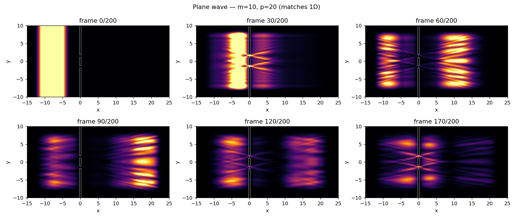

# Schroedinger

Numerical solutions of the time-dependent Schrödinger equation in Python, with animations of the wave function.



## Contents

| Folder | What it does | Method |
|---|---|---|
| [`1d/`](1d/) | A Gaussian wave packet in one dimension hitting square walls, a square well or a power-law potential. Shows reflection and tunnelling. | Finite differences in space, RK4 in time |
| [`2d/`](2d/) | A wave packet or a plane wave in two dimensions hitting a single slit, a double slit or a finite wall. Shows diffraction and interference. | Split-step Fourier (Strang splitting) with absorbing edges |

The 1D project was written by Dag-Morten and a friend, based on the blog post [Quantum mechanics simulation](https://ben.land/post/2022/03/09/quantum-mechanics-simulation/) by Benjamin J. Land. The 2D project was written later with an AI coding assistant as an extension of the 1D code, and keeps the same structure (`config.py`, `functions/`, `tools/`, `plot/`). See [`2d/README.md`](2d/README.md) for details on the method and the available scenarios.

Both projects use units where ħ = 1.

## Running

```bash
python -m venv .venv
source .venv/bin/activate
pip install -r requirements.txt

cd 1d && python main.py   # or: cd 2d && python main.py
```

Each project is run from its own folder, since the modules import `config` directly. Parameters are changed in `config.py` or with `config.update(...)` in `main.py`.

Note that the 1D simulation uses a small time step (dt = dx²) and 200 000 steps by default, so it takes a while before the animation appears. The 2D simulation runs in well under a minute.
