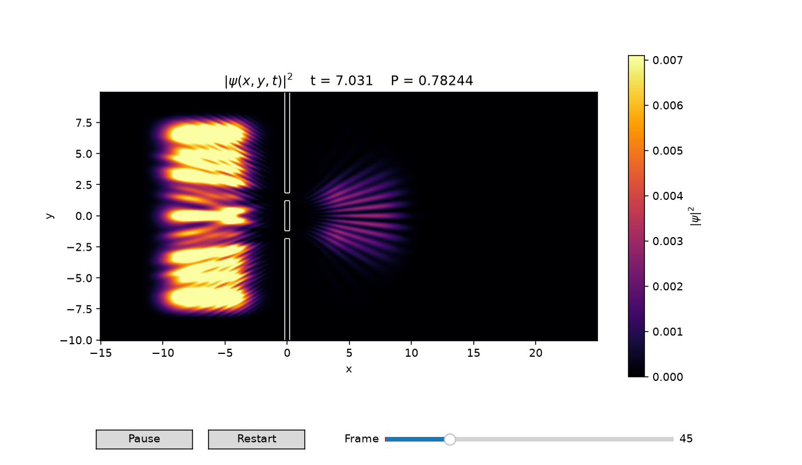

# Schrödinger — Akademie Olympia

[Norsk bokmål](README.nb.md) | [English](README.md)

Numeriske kvantesimuleringer for fysikk, forskning og undervisning.

Den valgfrie [lokale nettappen](docs/APP.md) virker på Windows, macOS og Linux
med Python 3.11+. Velg parametere i nettleseren, spill av to kjøringer sammen
og lagre komplette resultater som den andre bidragsyteren kan åpne uten ny beregning:

```powershell
& '.\.venv\Scripts\python.exe' -m pip install -e ".[app]"
& '.\.venv\Scripts\python.exe' -m schroedinger.app
```

Start med **Utforsk** og et ferdig forsøk. **Sammenlikn** lar deg endre én
parameter ved fast sluttid; resten av innstillingene finnes i **Avansert**.
Ferdige kjøringer kan spilles av, pauses og startes på nytt med valgfri
visningshastighet, uten ny beregning.
Lys visning fremhever svake mønstre; sammenlikning bruker felles fargeskala.
Regionandeler, tetthetsprofiler og veiledet kontroll av tidssteg/rutenett hjelper
med vurderingen. [Appveiledningen](docs/APP.md) forklarer målingene og begrensningene.
Velg **Fri bølgepakke – referanse (1D)** for en kontrollert sammenlikning av
middelposisjon og spredning med den analytiske løsningen. Se
[referanseforsøket](docs/FREE_WAVEPACKET.md) for formler og målte avvik.



Gjenskap figuren med `python -m schroedinger --headless --no-progress --snapshot-time 7 --output docs/images/double-slit.png`.
[JSON-rapporten](docs/images/double-slit.json) inneholder konfigurasjonen og faktisk lagret tidspunkt.

## Installer på Windows

Kjør fra prosjektmappen i PowerShell:

```powershell
python -m venv .venv
& '.\.venv\Scripts\python.exe' -m pip install -e ".[test]"
& '.\.venv\Scripts\python.exe' -m schroedinger
```

Miljøet trenger ikke aktiveres. På Linux/macOS brukes vanlig venv-aktivering
og `python -m pip install -e ".[test]"`.

## Prøv ulike forsøk

```powershell
# Dobbeltspalte:
& '.\.venv\Scripts\python.exe' -m schroedinger

# Enkeltspalte:
& '.\.venv\Scripts\python.exe' -m schroedinger --scenario single_slit

# Fri gaussisk bølgepakke:
& '.\.venv\Scripts\python.exe' -m schroedinger --scenario free --wave gaussian_packet

# Endelig barriere:
& '.\.venv\Scripts\python.exe' -m schroedinger --scenario wall --wave gaussian_packet

# Én dimensjon:
& '.\.venv\Scripts\python.exe' -m schroedinger --dimension 1

# Vis alle parameterne:
& '.\.venv\Scripts\python.exe' -m schroedinger --help
```

Bruk Pause/Play, Restart og glidebryteren for bilder i animasjonen. Tittelen
viser fysisk tid og samlet sannsynlighet som er igjen i simuleringsområdet.
Lukk vinduet for å avslutte.

Parametere kan endres i kommandoen, for eksempel `--slit-width 0.8`,
`--px 15`, `--dt 0.01` og `--nx 1024`. Kildekoden trenger ikke endres.

## Lagre resultat og kjør tester

```powershell
& '.\.venv\Scripts\python.exe' -m schroedinger --headless --output outputs/forsok.png
& '.\.venv\Scripts\python.exe' -m schroedinger --headless --snapshot-time 7 --output outputs/ved-t7.png
& '.\.venv\Scripts\python.exe' -m pytest -q
```

Eksporten skriver en PNG og en JSON med konfigurasjon, tidsverdier,
sannsynlighet, absorbert sannsynlighet, metode og minnebruk for bildene.
For spalteforsøk velges automatisk et bilde etter at pakken har passert
spaltene, omtrent t=7,2 med standardverdiene. Andre scenarioer bruker midten
av tidsintervallet. `--snapshot-time` velger ønsket fysisk tidspunkt;
nærmeste lagrede bilde brukes. Faktisk bildeindeks og tidspunkt lagres i JSON.

## Hva er rettet?

- Ugennomtrengelige 2D-vegger inngår i utbredelsesoperatoren. Bølgen slettes
  ikke ved hvert tidssteg. Lukket vegg bevarer sannsynligheten og slipper
  ikke bølgen gjennom.
- Kantabsorpsjon bruker en rate per tidsenhet. Den kan slås av med
  `--no-absorber`, og sannsynligheten den fjerner måles separat.
- 1D bruker som standard normbevarende Crank–Nicolson. RK4 finnes fortsatt
  med `--method rk4`, men har stabilitetskontroll og renormaliseres ikke
  skjult etter hvert steg.
- Bevegelsesmengdens fase inkluderer hbar. Forventningsverdier bruker riktig
  integrasjonselement og korrekt operatormultiplikasjon.
- Rutenettavstander beregnes fra grensene og antall punkter. Automatisk dt
  følger rutenettet; en eksplisitt dt beholdes.
- 2D-demoen lagrer sannsynlighetstetthet som float32 og bruker en firedel av
  minnet til de tidligere komplekse bildene.

Standardverdiene er demonstrasjonsinnstillinger. For kvantitative resultater
må både rutenett og tidssteg undersøkes for konvergens. Sammenlikn ved samme
fysiske sluttid: Hvis dt halveres, dobles antall steg. En gaussisk bølgepakke
har en energifordeling, så transmisjon gjennom en endelig vegg kan omfatte
både tunnelering og komponenter med energi over barrieren.

Gaussbredden beholder den opprinnelige definisjonen:
psi er proporsjonal med exp(-((x-x0)/sigma)^2). Standardavviket i posisjon
er derfor sigma/2.

Se [den engelske dokumentasjonen](README.md) for metoder, randbetingelser,
Python-API og flere presiseringer. Se [valideringen](docs/VALIDATION.md) for
testgrunnlaget og sammenlikningen med originalversjonen.

## Medforfattere og opprinnelse

Det opprinnelige 1D-prosjektet ble utviklet av medforfatterne
[Dag-Morten Sjøstrøm (@dagmortensj)](https://github.com/dagmortensj) og
[Dag-Vidar Krogstad Bauer (@dagvidb)](https://github.com/dagvidb), med utgangspunkt i
Benjamin J. Lands [Quantum mechanics simulation](https://ben.land/post/2022/03/09/quantum-mechanics-simulation/).
Den opprinnelige 2D-utvidelsen ble senere utviklet med en KI-basert
programmeringsassistent. Den videre utviklingen skjer i Akademie Olympia.

## Originalversjonen

Det uendrede utgangspunktet er bevart med
[`original`-taggen](https://github.com/olympia-academy/schroedinger/tree/original),
som peker på commit `a082b015aec9e74634d2331f9bca0149fc52f8ca`.
Der finnes de opprinnelige selvstendige 1D- og 2D-skriptene og illustrasjonene.
