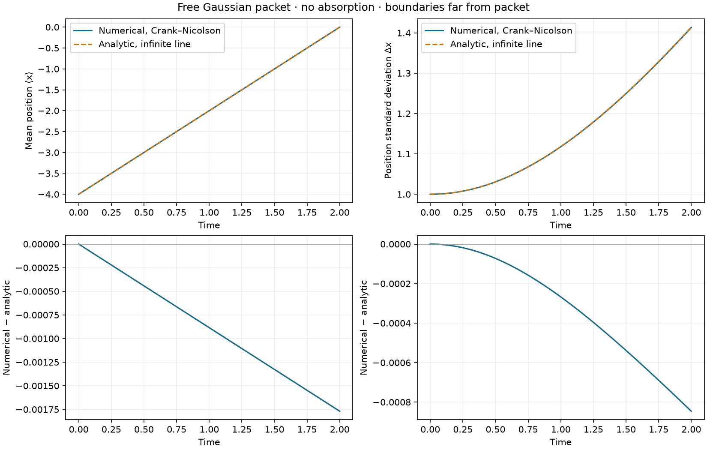

# Free Gaussian packet: position and spreading

[App guide](APP.md) · [Norsk README](../README.nb.md)

The **Fri bølgepakke – referanse (1D)** preset provides a controlled physical
reference before investigating barriers or slits. It uses the existing 1D
propagators without changing them. Crank–Nicolson is the default; RK4 remains
selectable subject to its existing time-step stability check.

## Physical problem

The initial state is an unchirped minimum-uncertainty Gaussian,

```text
ψ(x,0) ∝ exp(−(x−x₀)² / w²) exp(i p₀ x / ℏ).
```

The code's width parameter is `w = sigma_x`, so the initial standard deviation
of **position probability density** is `s₀ = w/2`, not `w`. Free evolution on
the infinite line gives

```text
⟨x⟩(t) = x₀ + p₀ t / m
Δx(t) = sqrt(s₀² + (ℏ t / (2 m s₀))²).
```

The first equation expresses uniform motion of the centre; the second is
spreading due to the initial momentum distribution. There is no initial
position–momentum covariance in this Gaussian. All quantities use the model's
chosen units; they are not automatically SI seconds or metres.

| Parameter | Preset value |
|---|---|
| Potential | Free, V=0 |
| Mass and ℏ | 1 and 1 |
| Initial centre and momentum | x₀=−4, p₀=2 |
| Width and initial position standard deviation | w=2, s₀=1 |
| Sampled x interval | [−12,12], 1024 nodes |
| Evolution | dt=0.002, 1000 steps, final t=2 |
| Saved frames | 101, including t=0 and t=2 |
| Absorber | Disabled |

At t=2 the analytic centre is 0 and the standard deviation is √2. The actual
finite-difference Dirichlet boundaries lie at the neighbouring ghost nodes,
`x_min − dx` and `x_max + dx`. They reflect; this is not an infinite-domain
solver. The reference is useful while the packet remains far from them.

## Measurements and validity

For each saved density, using the solver's uniform cell weight dx:

```text
P = Σ ρᵢ dx
μ = Σ xᵢ ρᵢ dx / P
Δx = sqrt(Σ (xᵢ−μ)² ρᵢ dx / P).
```

The centred variance avoids cancellation for packets far from x=0. These are
moments conditional on the probability remaining in the box. No saved data or
propagated state is renormalized or modified. Zero probability gives undefined
(NaN) moments. Densities are stored as float32 and sums use float64. The
separately reported norm drift comes from the original complex-state diagnostic.

The app suppresses the analytic overlay and error table for the entire run if
absorption is active, any saved probability is zero, or the analytic Gaussian's
estimated probability beyond the ghost boundaries exceeds 10⁻⁸ at any saved
time. This conservative tail criterion warns about boundary effects; it is
**not an error bound** or a guarantee of agreement with finite-box evolution.
Remaining numerical moments are still displayed with an explanation.

The moments CSV includes numerical and reference values, estimated outside
probability and `reference_usable`. Reference columns remain present even when
that flag is false and must then be interpreted with the stated limitations.
Existing schema-version-1 NPZ results can be analysed without propagation.
Only 1D free Gaussian runs receive this panel; other scenarios are unchanged.

## Numerical evidence

Maximum absolute discrepancies over saved times, using Crank–Nicolson and
otherwise identical physical settings:

| Nodes | dt | Max error in ⟨x⟩ | Max error in Δx |
|---:|---:|---:|---:|
| 512 | 0.002 | 0.007008 | 0.003326 |
| 1024 (preset) | 0.002 | 0.001770 | 0.000846 |
| 2047 (half dx) | 0.002 | 0.000463 | 0.000226 |
| 1024 | 0.001 | 0.001749 | 0.000831 |

This is consistent with spatial discretization being the dominant error in
these two observables at the preset resolution. Halving dt alone changes
them little, whereas halving dx reduces both errors substantially. Norm drift
is below 10⁻¹² in these runs and the maximum analytic outside probability is
below 10⁻¹⁵. Norm preservation does not imply continuum accuracy. Agreement
of two moments also does not establish correct phase or full wave function.



The [machine-readable report](images/free-wavepacket-reference.json) records
all four configurations and library versions. To reproduce it and the figure
plus a moments CSV, run from an installed repository environment:

```bash
python examples/free_wavepacket_reference.py --output outputs/free-wavepacket-reference
```

This script uses a noninteractive plotting backend and opens no GUI. It
requires the core dependencies; Streamlit is needed only for the browser app.
The app's existing **Kontroller numerisk nøyaktighet** controls can generate
the finer-grid and half-time-step runs as well.

Tests exercise Gaussian width conventions, conditional normalization, zero
probability, translated packets, opposite momentum, nonunit mass/ℏ, both 1D
integrators, grid refinement, saved-result analysis and invalid reference
assumptions. The UI test runs the preset and verifies its absorption warning.

```bash
python -m pytest tests/test_wavepacket.py tests/test_web_app.py -q
```
