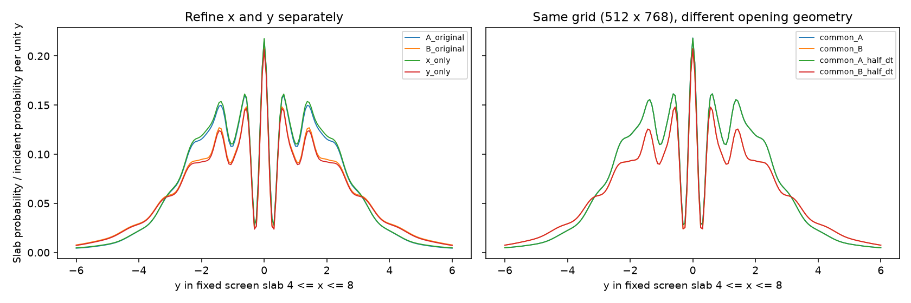

# What causes the 17.30% grid difference?

This follows the [default double-slit sensitivity study](SENSITIVITY.md).
The reported 17.30% is a relative L1 difference between central density
profiles at T=7.03125, not a 17.30% probability loss or a known error against
an exact solution. Both profiles use dt=0.01953125.

## Measure boundary coordinates, not just node counts

For a sine interval with N allowed points, its two excluded neighbouring
nodes are the zero-value boundaries. Their separation is `(N+1)*dy`.
`N*dy` is a raster node-count measure and does not give that separation.

The actual zero-node coordinates in the positive slit are:

| Quantity | A: 512x256 | B: 768x384 |
|---|---:|---:|
| Lower y boundary | 1.171875 | 1.197916667 |
| Upper y boundary | 1.875000 | 1.822916667 |
| Boundary separation | 0.703125 | 0.625000 |
| Slit centre | 1.5234375 | 1.510416667 |
| Distance between slit centres | 3.046875 | 3.020833333 |
| Left x wall face | -0.156250 | -0.156250 |
| Right x wall face | 0.156250 | 0.156250 |

The negative slit is the reflection about y=0. The finer grid's opening is
11.11% narrower in this discrete boundary-node interpretation, and the slit
separation decreases by about 0.85%. Thus the original comparison changes
the represented aperture as well as the resolution.

The wall node-count measures in the first report differ (0.390625 versus
0.364583), but **the x wall faces are identical**. Those counts alone would
misidentify the wall's boundary-coordinate thickness as changing here.

## Controlled experiments

Reproduce from the repository root after installing the package:

```bash
python examples/explain_grid_difference.py
```

The script reuses the two committed profiles from the first study, then
runs seven new cases sequentially without a GUI. It leaves production
propagators, default masks and parameters unchanged.

1. Refine only x: 768x256. Keep the original y opening and compare with A.
2. Refine only y: 512x384. Compare with B to assess the remaining x effect.
3. Use one common 512x768 grid and construct two experimental masks:
   one has exactly A's zero-node boundaries, the other exactly B's.
   All internal boundary coordinates belong to this common lattice.
   Between these two runs, only the aperture geometry changes.
4. Halve dt for both common-grid geometries, and also for B on 768x384.
5. Resample each fixed common-grid profile onto the two original y grids,
   then back to the measurement samples. This measures the extraction's
   interpolation sensitivity without changing numerical propagation.

The matched masks use strict inequalities inside the opening, so the
specified zero-value boundary nodes remain excluded. Tests verify that the
measured coordinates survive the transfer, and reject unrepresentable
coordinates instead of silently rounding them.

The common grid retains A's x spacing while refining y by a factor of three.
It is an experimental reference, not an exact continuum solution. Outer
ghost-node positions still shift with spacing; box-edge and absorber
effects are not separately eliminated by matching the internal wall.

## Results

The [recorded data](data/grid-difference-attribution.json) contain all seven
new profiles, their native sampling, mask coordinates, times and probability
budgets. The original two profiles are retained as references. Runs used
the same environment as the first study and the same production propagators.

| Comparison | Reference | Relative profile L1 | Shape L1 |
|---|---|---:|---:|
| Original A vs original B | B | 17.30% | 13.11% |
| Refine only x, retain A's y grid | A | 1.84% | 0.82% |
| Refine only y, retain A's x grid | B | 2.03% | 0.59% |
| Original A vs common-grid geometry A | common A | 2.58% | 1.09% |
| Geometry A vs B on the same 512x768 grid | common B | **19.94%** | **13.40%** |
| Original B vs common-grid geometry B | common B | 1.09% | 0.46% |
| Common A, dt vs dt/2 | smaller dt | 0.08% | 0.09% |
| Common B, dt vs dt/2 | smaller dt | 0.03% | 0.03% |
| Original B, dt vs dt/2 | smaller dt | 0.07% | 0.06% |

Here dt is 0.01953125; its half is 0.009765625. Probability-budget errors
remain below 1.5e-12. The reference column specifies each denominator;
these rows cannot be added or directly subtracted as error contributions.



Resampling one fixed profile onto the original y grids and back gives
0.33% difference for geometry A and 0.36% for B. This is a diagnostic of
the measurement extraction, not a rigorous bound on interpolation error
for every profile. It is much smaller than the observed 17.30%.

**The dominant explanation is the changed discrete aperture geometry.**
Changing only that geometry on one grid produces a difference comparable
to the original discrepancy. Keeping its coordinates fixed reduces the
tested grid differences to around 1–3%, and the time-step and resampling
controls are smaller still. In the common-grid geometry comparison,
the integrated central profile area is 10.85% larger for A; the L1
difference is 13.40% after normalizing away area. Both intensity and shape change.

This control changes opening width and slit-centre separation together.
It does not establish a separate causal percentage for those two changes.
The 11.11% width reduction is larger proportionally than the 0.85% change
in separation, but isolating each would require further controls.

Norsk: Den første sammenlikningen endret både oppløsning og den spalten
løseren faktisk representerer. Ved identisk rutenett gir de to geometriene
omtrent 19,9% profilforskjell. Med geometrien holdt fast er de undersøkte
romforskjellene rundt 1–3%, mens halvert dt gir under 0,1%. Det peker mot
geometrien som hovedårsak, uten å bevise at restfeilen er en kjent
kontinuumfeil eller at alle senere tider er like robuste.

## Interpretation limits

These comparisons distinguish major mechanisms, but their percentage
differences are not additive causal fractions. The L1 norm takes absolute
values, the reference denominator changes where stated, and aperture
geometry interacts with discretization and directional splitting.

Even if matching boundaries reduces the difference substantially, the
default nominal slit width 0.6 is not thereby certified to approximate a
continuum slit of width exactly 0.6. Further matched-geometry refinements,
other times and independent reference solutions remain necessary for
quantitative claims.

A suitable next experiment is a nested grid family with explicitly aligned
boundary coordinates, followed separately by a study of the intended
continuum width 0.6. Merely increasing nx/ny with the nominal mask parameters
unchanged mixes resolution and geometry again. No automatic mask correction
or default change is proposed by this investigation.
