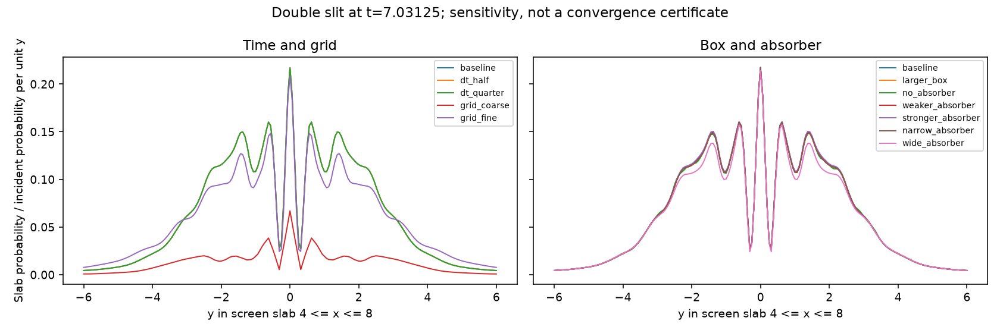

# Default double-slit sensitivity study

**The default image is not spatially converged by this evidence.** At a
common time step, changing 512x256 to 768x384 changes the measured central
profile by 17.30% in the L1 measure below. Reducing dt has a much smaller
effect for this particular observable and time. No solver or demo defaults
were changed as a result of this study.

The [controlled follow-up](GRID_DIFFERENCE.md) identifies changed discrete
aperture geometry as the dominant explanation: the two measured geometries
produce 19.94% profile difference on the same grid, while the tested
matched-geometry refinements differ by around 1–3%. This does not certify
the nominal continuum geometry or late-time behavior.

Norsk: Standardbildet er fortsatt en kvalitativ demonstrasjon. Normbevaring
og små tidsfeil er ikke tilstrekkelig til å dokumentere et konvergert
interferensmønster. Se [den norske veiledningen](NUMERIKK.nb.md).

## Reproduce

From the repository root, with the package installed:

```bash
python examples/double_slit_sensitivity.py --output outputs/sensitivity
```

The script runs 11 cases sequentially, without GUI windows, keeping only
initial and final float32 density frames. It writes `study.json`, `table.md`
and `profiles.png`. Runtime depends on the machine. The committed
[JSON data](data/double-slit-sensitivity.json) include every configuration,
grid spacing, physical time, profile and dependency version from the local
run on 2026-10-31. The propagators are those in main commit `923b3e9`.

## Setup and observable

- Default incident train: hbar=1, m=10, p=(20,0), x0=-8; super-Gaussian
  x-envelope width 4, uniform in y. Nominal slit width 0.6, separation 3,
  wall thickness 0.4 at x=0.
- All cases stop at **T=7.03125**, the time of the README illustration.
- Baseline: 512x256, x in [-15,25), y in [-10,10), dt=0.0390625,
  absorber rate 30 and width fraction 0.1.
- Integrate density over the fixed screen slab **4 <= x <= 8**; weight
  partially intersected cells by their overlap with that slab. Compare
  profiles only on the same central **-6 <= y <= 6** interval.
- Divide each profile by its initial incident probability per unit y at
  y=0. The wider uniform train otherwise changes normalized incident
  amplitude merely because the box is wider. Raw total probabilities below
  do not receive this correction and should not be interpreted as directly
  comparable transmission coefficients across box sizes.
- Interpolate profiles linearly onto 193 common y samples. This finite
  screen-slab observable is neither a flux-integrated detector signal nor
  a pointwise wave-function error. It also loses phase information.

For profiles q and reference r, **profile L1** means
`sum(abs(q-r))/sum(abs(r))`. **Shape L1** first normalizes each profile to
unit sum, separating shape changes from overall amplitude changes.
The denominator depends on the stated reference; these are relative
differences, not certified errors against an exact solution.

## Results

The table compares each case with the baseline. Smaller dt cases are
0.01953125 and 0.009765625. Both alternative grids use dt=0.01953125.

| Case | P remaining | Absorbed | Profile L1 vs baseline | Shape L1 vs baseline |
|---|---:|---:|---:|---:|
| baseline | 0.782444 | 0.217556 | 0.00% | 0.00% |
| dt_half | 0.782487 | 0.217513 | 0.05% | 0.05% |
| dt_quarter | 0.782498 | 0.217502 | 0.06% | 0.06% |
| grid_coarse (256x128) | 0.686378 | 0.313622 | 79.64% | 30.08% |
| grid_fine (768x384) | 0.782434 | 0.217566 | 16.12% | 13.06% |
| larger_box | 0.800082 | 0.199918 | 0.41% | 0.28% |
| no_absorber | 1.000000 | 0.000000 | 0.83% | 0.82% |
| weaker_absorber (rate 15) | 0.789442 | 0.210558 | 0.25% | 0.15% |
| stronger_absorber (rate 60) | 0.775985 | 0.224015 | 0.45% | 0.22% |
| narrow_absorber (fraction 0.05) | 0.893079 | 0.106921 | 0.41% | 0.30% |
| wide_absorber (fraction 0.15) | 0.557052 | 0.442948 | 5.20% | 3.15% |

The larger box is x in [-25,35), y in [-15,15), with 768x384 points.
It preserves dx and dy. The absorber fraction remains 0.1, so its physical
width grows too: **this comparison changes box size and physical layer
width together**, and cannot isolate one cause. The normalized uniform
incident state also occupies a different finite domain.

Paired comparisons that isolate dt or hold it fixed for the grid study:

| Profile comparison | Reference | Relative L1 difference |
|---|---|---:|
| dt_half vs dt_quarter, 512x256 | dt_quarter | 0.01% |
| grid_coarse vs dt_half, same dt | dt_half | 79.63% |
| dt_half vs grid_fine, same dt | grid_fine | 17.30% |



All cases satisfy P + measured absorption = 1 to within 1.1e-12 at the
saved times. That agreement coexists with substantial profile differences.

## Why the grid comparison needs care

Nominal geometry remains fixed, but its raster representation changes:

| Grid | dx=dy | Wall node count * dx | Each opening's node count * dy |
|---|---:|---:|---:|
| 256x128 | 0.156250 | 0.468750 | 0.625000 |
| 512x256 | 0.078125 | 0.390625 | 0.625000 |
| 768x384 | 0.052083 | 0.364583 | 0.572917 |

These are node-count measures, **not exact effective continuum widths**.
The sine boundary lies at neighbouring excluded nodes; see the boundary
guide. Differences include spatial resolution and changed discrete geometry.
With p=20, the wavelength is about 0.314: the coarsest grid has only about
two samples per wavelength, barely above the Nyquist threshold. Passing
parameter validation does not imply adequate accuracy.

## What can and cannot be concluded

- For this early central-slab observable, time-step sensitivity is much
  smaller than the tested spatial sensitivity.
- Several boundary/absorber changes alter the early central profile by
  less than 1%, while the wider absorber changes it by about 5%. Total
  absorbed probability changes much more. These are different observables.
- This does not establish independence from outer boundaries at late times.
  Uniform illumination in y already occupies the transverse edge layers
  at t=0; it is not a packet initially far from every edge.
- There is no continuum reference for this double-slit run. The study does
  not certify a convergence rate, precise fringe positions, transmission
  fractions, or the rest of the default time history to T=31.25.
- A quantitative follow-up should use further grid refinements with
  carefully tracked geometry, compare more times, enlarge the domain with
  controlled physical absorber widths, and compare a localized y-envelope.
  Refining dt on the finer grids must also be checked before attributing
  all remaining changes to space.
